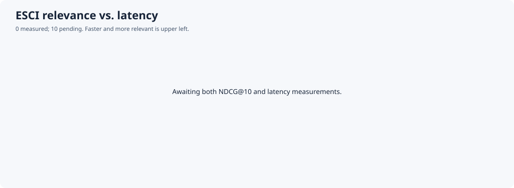

# Turbopuffer experiments

Utilities for indexing datasets into Turbopuffer and experimenting with search
parameters.

## Setup

This project uses Python 3.15.2, managed by asdf, and `uv` for the environment
and dependencies:

```sh
uv sync
uv run pre-commit install
```

The `tpuf-helpers` and `cheat-at-search` dependencies are pinned to specific Git
revisions in `pyproject.toml`.

## Index the ESCI corpus

Set `TURBOPUFFER_API_KEY`, then run:

```sh
uv run index-esci --namespace esci-products --region gcp-us-central1
```

The command uses `cheat_at_search.esci_data.corpus` and writes raw fields,
analyzer-specific field copies, a `passage` field, and one Voyage 4 embedding
of that passage.
Searchable names use `logical_field__tokenizer__language__options`, such as
`title__word_v4__es__stem_stop_fold` and `title__kuromoji__ja`. It includes
`word_v4`, `word_v2`, whitespace, pre-tokenized, fuzzy, and BM25 length
normalization variants. Native embedding writes are currently limited to 256
documents per batch, which is also the indexing default.

Use `--limit N` to index a subset or `--dry-run` to count documents without
writing. `--drop-existing` explicitly deletes the target namespace before
indexing, so use it with care. `--skip-existing-docs` looks up IDs once per
batch and skips rows already in the namespace; use it to resume with the same
schema without re-embedding completed documents. These options are mutually
exclusive. The region defaults to `TURBOPUFFER_REGION` or `gcp-us-central1`.

## Query the ESCI corpus

Provide a CSV with `query` and `locale` columns, then run:

```sh
uv run query --queries queries.csv --output results.csv
```

The batch command assigns query IDs (`q1`, `q2`, ...), applies the locale filter,
and writes ranked document IDs and scores. Requests are sent in batches through
Turbopuffer's multi-query API. Queries combine BM25 title and description scores,
with title weighted twice as heavily. Queries with no hits are emitted with the
`-1,-1,-1` sentinel row.

## Search architecture

`TPufStrategy` owns the ESCI document mapping, namespace schema, and query
construction. The outer `Indexer` and `Searcher` handle batched namespace I/O,
so relevance experiments can focus on the strategy without changing the runners.

## ESCI 5,000-query leaderboard

The ten variants below are being evaluated on the same 5,000-query Referee
split (`esci-products`, seed `20261122`). The branch links point to the
experiment histories; commit hashes identify the exact versions under test.
Rows are not ranked until the new NDCG@10 results are available. Latency will
report end-to-end p50 / p95 in milliseconds on the same fixed 100-query sample
for each variant, measured independently of the shared retrieval pass.

| Variant | Latency p50 / p95 (ms) | Experiment branch | Evaluated commit | NDCG@10 |
|---|---:|---|---|---:|
| Learned pairwise reranker | Pending | [research/learned-rank](https://github.com/softwaredoug/tpuf-optimize/tree/research/learned-rank) | `adf9768` | Pending |
| Identifier-gated RRF | Pending | [confidence-aware-fusion](https://github.com/softwaredoug/tpuf-optimize/tree/confidence-aware-fusion) | `7e22661` | Pending |
| Deterministic product reranker | Pending | [research-product-rerank](https://github.com/softwaredoug/tpuf-optimize/tree/research-product-rerank) | `7ffd772` | Pending |
| Min-max score fusion | Pending | [research-score-fusion](https://github.com/softwaredoug/tpuf-optimize/tree/research-score-fusion) | `41e64d4` | Pending |
| 2:1 Voyage-4 + BM25 RRF | Pending | [experiment-6-hybrid-rrf](https://github.com/softwaredoug/tpuf-optimize/tree/experiment-6-hybrid-rrf) | `cc5fc8a` | Pending |
| Four-channel RRF | Pending | [exp7-rank-fusion](https://github.com/softwaredoug/tpuf-optimize/tree/exp7-rank-fusion) | `3f4c9bc` | Pending |
| Passage BM25 + fuzzy title/brand | Pending | [exp3-bm25-passage-fuzzy](https://github.com/softwaredoug/tpuf-optimize/tree/exp3-bm25-passage-fuzzy) | `c46c935` | Pending |
| Title + locale-aware passage BM25 | Pending | [relevance/field-weights-passage](https://github.com/softwaredoug/tpuf-optimize/tree/relevance/field-weights-passage) | `cdb2d64` | Pending |
| Title + folded passage BM25 | Pending | [experiment-2-locale-analyzers](https://github.com/softwaredoug/tpuf-optimize/tree/experiment-2-locale-analyzers) | `9340694` | Pending |
| Voyage-4-only exact kNN | Pending | [experiment/voyage4-only](https://github.com/softwaredoug/tpuf-optimize/tree/experiment/voyage4-only) | `3505c15` | Pending |



The Pareto frontier highlights variants that no other measured variant
matches or beats on both p50 latency and NDCG@10 while improving at least
one. Pending rows are not plotted. After updating the table, regenerate
the chart with `uv run python scripts/plot_pareto.py`.
