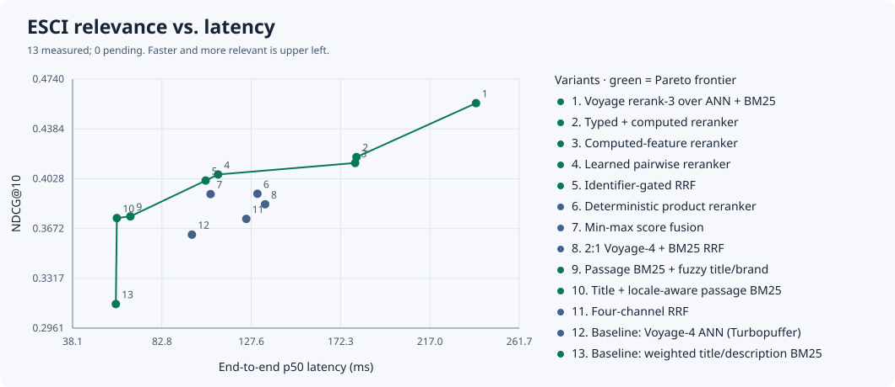
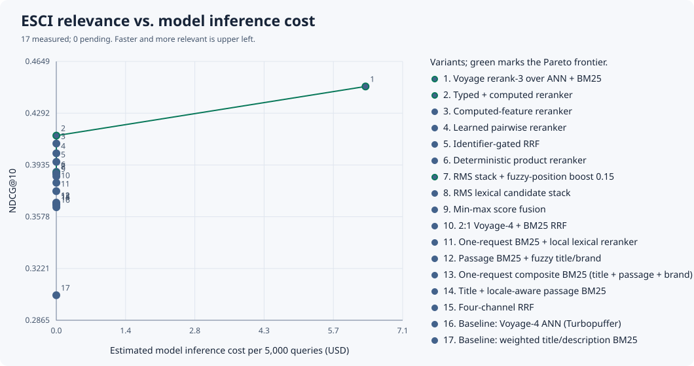

# Turbopuffer experiments

Utilities for indexing datasets into Turbopuffer and experimenting with search
parameters.

## Optimization workflow

This repository is a harness for controlled retrieval experiments. The `main`
branch keeps the simple title/description BM25 baseline; experiment branches
contain alternate query strategies and their evaluation notes. Keep training
and holdout data separate, and use a fresh matched Referee session for final
benchmarks. The shared `Indexer`, `Searcher`, and batch runners provide the
common data and I/O layer.

## Setup

This project uses Python 3.15.2, managed by asdf, and `uv` for the environment
and dependencies:

```sh
uv sync
uv run pre-commit install
```

The `tpuf-helpers` and `cheat-at-search` dependencies are pinned to specific Git
revisions in `pyproject.toml`.

## Index the ESCI corpus

Set `TURBOPUFFER_API_KEY`, then run:

```sh
uv run index-esci --namespace esci-products --region gcp-us-central1
```

The command uses `cheat_at_search.esci_data.corpus` and writes raw fields,
analyzer-specific field copies, a `passage` field, and one Voyage 4 embedding
of that passage.
Searchable names use `logical_field__tokenizer__language__options`, such as
`title__word_v4__es__stem_stop_fold` and `title__kuromoji__ja`. It includes
`word_v4`, `word_v2`, whitespace, pre-tokenized, fuzzy, and BM25 length
normalization variants. Native embedding writes are currently limited to 256
documents per batch, which is also the indexing default.

Use `--limit N` to index a subset or `--dry-run` to count documents without
writing. `--drop-existing` explicitly deletes the target namespace before
indexing, so use it with care. `--skip-existing-docs` looks up IDs once per
batch and skips rows already in the namespace; use it to resume with the same
schema without re-embedding completed documents. These options are mutually
exclusive. The region defaults to `TURBOPUFFER_REGION` or `gcp-us-central1`.

## Query the ESCI corpus

Provide a CSV with `query` and `locale` columns, then run:

```sh
uv run query --queries queries.csv --output results.csv
```

The batch command assigns query IDs (`q1`, `q2`, ...), applies the locale filter,
and writes ranked document IDs and scores. Requests are sent in batches through
Turbopuffer's multi-query API. Queries combine BM25 title and description scores,
with title weighted twice as heavily. Queries with no hits are emitted with the
`-1,-1,-1` sentinel row.

## Search architecture

`TPufStrategy` owns the ESCI document mapping, namespace schema, and query
construction. The outer `Indexer` and `Searcher` handle batched namespace I/O,
so relevance experiments can focus on the strategy without changing the runners.

## ESCI 5,000-query leaderboard

The generated table below includes both the existing leaderboard cohort and
the fresh lexical comparison. Cohort labels keep different query splits
distinct; Pareto frontiers are computed separately within each cohort.

To measure a single checkout without a client-side result or feature cache,
use an explicit `query_id,query,locale` CSV and keep the inputs and outputs
outside the repository in a private directory:

```sh
uv run query --queries "$RUN/queries.csv" --output "$RUN/rankings.csv" \
  --benchmark-db "$RUN/timings.sqlite"
```

Benchmark mode defaults to one query per batch. It records rankings and
latency together, counting only the successful attempt after any HTTP 429s.
For larger `--batch-size` values, `latency_ms` in the checkpoint's `queries`
table is successful batch time divided by the number of user queries. This
is amortized time, not individual response latency. `--resume` continues
the same run after interruption; use a fresh database for every new run or
variant. Turbopuffer's internal caching is outside this tool's control.

The final benchmark runs ten leaders selected from prior holdout results,
two baselines, and the accepted Voyage rerank-3 variant, one variant at a time,
on the same new 5,000-query Referee split.
Every timing and submitted top 10 comes from the same independent execution.
Prior holdout scores and the incomplete shared-retrieval run are not included.
The Pareto charts use full-split NDCG; pending variants are not plotted. The
cost column estimates external embedding/reranker inference per 5,000-query run;
Turbopuffer database charges are excluded.

<!-- esci-benchmark:start -->

Historical leaderboard variants used the same 5,000 Referee queries. The second NDCG column covers the 4,861 queries not found in 51 available historical task artifacts.

Fresh lexical rows use a separate 5,000-query Referee session. Their disjoint column covers 4,819 queries after excluding 181 overlaps with 62 historical task artifacts. Compare values within a cohort, not across cohorts.

Classes: lexical; hybrid (lexical + embedding, including rule-based reranking on both); LTR (Learning to Rank), a classic ML reranker using query-dependent, query, and document features; third-party reranker. Pure embedding retrieval is listed separately.
| Variant | Cohort | Class | NDCG@10 (full) | NDCG@10 (disjoint) | p50 (ms) | p95 (ms) | Cost* (USD/5,000 queries) | Commit |
|---|---|---|---:|---:|---:|---:|---:|---|
| [Voyage rerank-3 over ANN + BM25](https://github.com/softwaredoug/tpuf-optimize/tree/experiment/tpuf-native-rerankers) | Historical leaderboard | Third-party reranker | 0.45677 | 0.45620 | 240.07 | 381.75 | $6.346637* | [`0a5816e`](https://github.com/softwaredoug/tpuf-optimize/commit/0a5816e) |
| [Typed + computed reranker](https://github.com/softwaredoug/tpuf-optimize/tree/innovate-typed-computed-ltr) | Historical leaderboard | LTR | 0.41825 | 0.41771 | 180.22 | 215.46 | $0.001637* | [`6508e87`](https://github.com/softwaredoug/tpuf-optimize/commit/6508e87) |
| [Computed-feature reranker](https://github.com/softwaredoug/tpuf-optimize/tree/innovate-computed-ltr-features) | Historical leaderboard | LTR | 0.41405 | 0.41329 | 179.54 | 252.30 | $0.001637* | [`e64100d`](https://github.com/softwaredoug/tpuf-optimize/commit/e64100d) |
| [Learned pairwise reranker](https://github.com/softwaredoug/tpuf-optimize/tree/research/learned-rank) | Historical leaderboard | LTR | 0.40582 | 0.40517 | 110.94 | 206.48 | $0.001637* | [`adf9768`](https://github.com/softwaredoug/tpuf-optimize/commit/adf9768) |
| [Identifier-gated RRF](https://github.com/softwaredoug/tpuf-optimize/tree/confidence-aware-fusion) | Historical leaderboard | Hybrid | 0.40152 | 0.40100 | 104.75 | 171.69 | $0.001637* | [`7e22661`](https://github.com/softwaredoug/tpuf-optimize/commit/7e22661) |
| [Deterministic product reranker](https://github.com/softwaredoug/tpuf-optimize/tree/research-product-rerank) | Historical leaderboard | Hybrid | 0.39209 | 0.39147 | 130.64 | 184.08 | $0.001637* | [`7ffd772`](https://github.com/softwaredoug/tpuf-optimize/commit/7ffd772) |
| [Min-max score fusion](https://github.com/softwaredoug/tpuf-optimize/tree/research-score-fusion) | Historical leaderboard | Hybrid | 0.39180 | 0.39126 | 107.18 | 142.44 | $0.001637* | [`41e64d4`](https://github.com/softwaredoug/tpuf-optimize/commit/41e64d4) |
| [2:1 Voyage-4 + BM25 RRF](https://github.com/softwaredoug/tpuf-optimize/tree/experiment-6-hybrid-rrf) | Historical leaderboard | Hybrid | 0.38454 | 0.38382 | 134.50 | 207.70 | $0.001637* | [`cc5fc8a`](https://github.com/softwaredoug/tpuf-optimize/commit/cc5fc8a) |
| [Passage BM25 + fuzzy title/brand](https://github.com/softwaredoug/tpuf-optimize/tree/exp3-bm25-passage-fuzzy) | Historical leaderboard | Lexical | 0.37588 | 0.37519 | 67.03 | 106.56 | $0.000000* | [`c46c935`](https://github.com/softwaredoug/tpuf-optimize/commit/c46c935) |
| [Title + locale-aware passage BM25](https://github.com/softwaredoug/tpuf-optimize/tree/relevance/field-weights-passage) | Historical leaderboard | Lexical | 0.37469 | 0.37398 | 60.28 | 79.78 | $0.000000* | [`cdb2d64`](https://github.com/softwaredoug/tpuf-optimize/commit/cdb2d64) |
| [Four-channel RRF](https://github.com/softwaredoug/tpuf-optimize/tree/exp7-rank-fusion) | Historical leaderboard | Hybrid | 0.37407 | 0.37316 | 125.09 | 203.82 | $0.001637* | [`3f4c9bc`](https://github.com/softwaredoug/tpuf-optimize/commit/3f4c9bc) |
| [Baseline: Voyage-4 ANN (Turbopuffer)](https://github.com/softwaredoug/tpuf-optimize/tree/experiment-6-hybrid-rrf) | Historical leaderboard | Embedding | 0.36286 | 0.36236 | 97.85 | 124.41 | $0.001637* | [`cc5fc8a`](https://github.com/softwaredoug/tpuf-optimize/commit/cc5fc8a) |
| [Baseline: weighted title/description BM25](https://github.com/softwaredoug/tpuf-optimize/tree/main) | Historical leaderboard | Lexical | 0.31331 | 0.31266 | 59.76 | 72.38 | $0.000000* | [`1768df7`](https://github.com/softwaredoug/tpuf-optimize/commit/1768df7) |
| [RMS stack + fuzzy-position boost 0.15](https://github.com/softwaredoug/tpuf-optimize/tree/experiment/lexical-union-position) | Fresh lexical | Lexical | 0.38834 | 0.38955 | 94.09 | 162.60 | $0.000000* | [`d663a92`](https://github.com/softwaredoug/tpuf-optimize/commit/d663a92) |
| [RMS lexical candidate stack](https://github.com/softwaredoug/tpuf-optimize/tree/experiment/lexical-union-position) | Fresh lexical | Lexical | 0.38797 | 0.38926 | 91.40 | 150.97 | $0.000000* | [`038e845`](https://github.com/softwaredoug/tpuf-optimize/commit/038e845) |
| [Passage BM25 + fuzzy title/brand](https://github.com/softwaredoug/tpuf-optimize/tree/exp3-bm25-passage-fuzzy) | Fresh lexical | Lexical | 0.37077 | 0.37181 | 69.22 | 114.81 | $0.000000* | [`c46c935`](https://github.com/softwaredoug/tpuf-optimize/commit/c46c935) |

*Estimated external model inference per 5,000-query run. Voyage-4 query embedding uses a UTF-8-bytes/4 token proxy (0.06 USD/million tokens); lexical-only and local CPU rankers add no model inference charge. Excludes Turbopuffer database/query charges and index-time embedding. Voyage rerank-3 uses $0.05/M and a 25,380-token-per-query training proxy.

- **Lexical** — BM25 and other lexical matching only.
- **Hybrid** — combines lexical + embedding retrieval/fusion, including rule-based reranking over those candidates.
- **LTR** — classic ML reranker using query-dependent, query, and document features.
- **Third-party reranker** — hosted reranking model such as Voyage rerank-3.
- **Embedding** — pure embedding retrieval; listed separately from hybrid.






<!-- esci-benchmark:end -->

Refresh the table and all three Pareto charts from the aggregate-only JSON with
`uv run python scripts/render_esci_benchmark.py`.

For context, the separate 1,000-query training-only native reranker experiment
estimated 25.38M rerank-input tokens by a chars/4 proxy. At $0.05/M, linear
scaling to 5,000 queries estimates `$6.35` for Voyage rerank-3; its leaderboard
cost cell also includes the small Voyage-4 query-embedding estimate. Cohere's
training-only estimate was `$12.69` per 5,000 queries. The rerank API does not
return model token usage or per-request cost.
