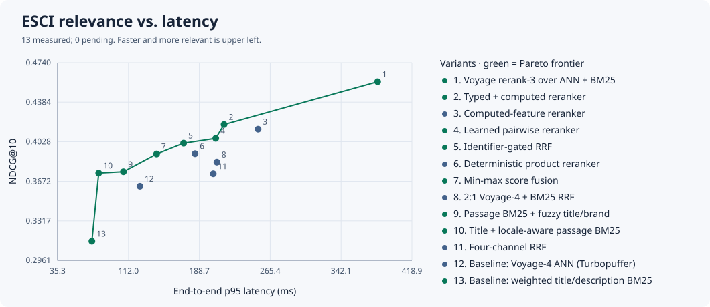

# Turbopuffer experiments

Utilities for indexing datasets into Turbopuffer and experimenting with search
parameters.

## Setup

This project uses Python 3.15.2, managed by asdf, and `uv` for the environment
and dependencies:

```sh
uv sync
uv run pre-commit install
```

The `tpuf-helpers` and `cheat-at-search` dependencies are pinned to specific Git
revisions in `pyproject.toml`.

## Index the ESCI corpus

Set `TURBOPUFFER_API_KEY`, then run:

```sh
uv run index-esci --namespace esci-products --region gcp-us-central1
```

The command uses `cheat_at_search.esci_data.corpus` and writes raw fields,
analyzer-specific field copies, a `passage` field, and one Voyage 4 embedding
of that passage.
Searchable names use `logical_field__tokenizer__language__options`, such as
`title__word_v4__es__stem_stop_fold` and `title__kuromoji__ja`. It includes
`word_v4`, `word_v2`, whitespace, pre-tokenized, fuzzy, and BM25 length
normalization variants. Native embedding writes are currently limited to 256
documents per batch, which is also the indexing default.

Use `--limit N` to index a subset or `--dry-run` to count documents without
writing. `--drop-existing` explicitly deletes the target namespace before
indexing, so use it with care. `--skip-existing-docs` looks up IDs once per
batch and skips rows already in the namespace; use it to resume with the same
schema without re-embedding completed documents. These options are mutually
exclusive. The region defaults to `TURBOPUFFER_REGION` or `gcp-us-central1`.

## Query the ESCI corpus

Provide a CSV with `query` and `locale` columns, then run:

```sh
uv run query --queries queries.csv --output results.csv
```

The batch command assigns query IDs (`q1`, `q2`, ...), applies the locale filter,
and writes ranked document IDs and scores. Requests are sent in batches through
Turbopuffer's multi-query API. Queries combine BM25 title and description scores,
with title weighted twice as heavily. Queries with no hits are emitted with the
`-1,-1,-1` sentinel row.

## Search architecture

`TPufStrategy` owns the ESCI document mapping, namespace schema, and query
construction. The outer `Indexer` and `Searcher` handle batched namespace I/O,
so relevance experiments can focus on the strategy without changing the runners.

## ESCI 5,000-query leaderboard

To measure a single checkout without a client-side result or feature cache,
use an explicit `query_id,query,locale` CSV and keep the inputs and outputs
outside the repository in a private directory:

```sh
uv run query --queries "$RUN/queries.csv" --output "$RUN/rankings.csv" \
  --benchmark-db "$RUN/timings.sqlite"
```

Benchmark mode defaults to one query per batch. It records rankings and
latency together, counting only the successful attempt after any HTTP 429s.
For larger `--batch-size` values, `latency_ms` in the checkpoint's `queries`
table is successful batch time divided by the number of user queries. This
is amortized time, not individual response latency. `--resume` continues
the same run after interruption; use a fresh database for every new run or
variant. Turbopuffer's internal caching is outside this tool's control.

The final benchmark runs ten leaders selected from prior holdout results and
two baselines, one variant at a time, on a new 5,000-query Referee split.
Every timing and submitted top 10 comes from the same independent execution.
Prior holdout scores and the incomplete shared-retrieval run are not included.
The Pareto charts use full-split NDCG; pending variants are not plotted.

<!-- esci-benchmark:start -->

Scored variants used the same 5,000 Referee queries. The second NDCG column covers the 4,861 queries not found in 51 available historical task artifacts.

| Variant | NDCG@10 (full) | NDCG@10 (disjoint) | p50 (ms) | p95 (ms) | Commit |
|---|---:|---:|---:|---:|---|
| [Typed + computed reranker](https://github.com/softwaredoug/tpuf-optimize/tree/innovate-typed-computed-ltr) | 0.41825 | 0.41771 | 180.22 | 215.46 | [`6508e87`](https://github.com/softwaredoug/tpuf-optimize/commit/6508e87) |
| [Computed-feature reranker](https://github.com/softwaredoug/tpuf-optimize/tree/innovate-computed-ltr-features) | 0.41405 | 0.41329 | 179.54 | 252.30 | [`e64100d`](https://github.com/softwaredoug/tpuf-optimize/commit/e64100d) |
| [Learned pairwise reranker](https://github.com/softwaredoug/tpuf-optimize/tree/research/learned-rank) | 0.40582 | 0.40517 | 110.94 | 206.48 | [`adf9768`](https://github.com/softwaredoug/tpuf-optimize/commit/adf9768) |
| [Identifier-gated RRF](https://github.com/softwaredoug/tpuf-optimize/tree/confidence-aware-fusion) | 0.40152 | 0.40100 | 104.75 | 171.69 | [`7e22661`](https://github.com/softwaredoug/tpuf-optimize/commit/7e22661) |
| [Deterministic product reranker](https://github.com/softwaredoug/tpuf-optimize/tree/research-product-rerank) | 0.39209 | 0.39147 | 130.64 | 184.08 | [`7ffd772`](https://github.com/softwaredoug/tpuf-optimize/commit/7ffd772) |
| [Min-max score fusion](https://github.com/softwaredoug/tpuf-optimize/tree/research-score-fusion) | 0.39180 | 0.39126 | 107.18 | 142.44 | [`41e64d4`](https://github.com/softwaredoug/tpuf-optimize/commit/41e64d4) |
| [2:1 Voyage-4 + BM25 RRF](https://github.com/softwaredoug/tpuf-optimize/tree/experiment-6-hybrid-rrf) | 0.38454 | 0.38382 | 134.50 | 207.70 | [`cc5fc8a`](https://github.com/softwaredoug/tpuf-optimize/commit/cc5fc8a) |
| [Passage BM25 + fuzzy title/brand](https://github.com/softwaredoug/tpuf-optimize/tree/exp3-bm25-passage-fuzzy) | 0.37588 | 0.37519 | 67.03 | 106.56 | [`c46c935`](https://github.com/softwaredoug/tpuf-optimize/commit/c46c935) |
| [Title + locale-aware passage BM25](https://github.com/softwaredoug/tpuf-optimize/tree/relevance/field-weights-passage) | 0.37469 | 0.37398 | 60.28 | 79.78 | [`cdb2d64`](https://github.com/softwaredoug/tpuf-optimize/commit/cdb2d64) |
| [Four-channel RRF](https://github.com/softwaredoug/tpuf-optimize/tree/exp7-rank-fusion) | 0.37407 | 0.37316 | 125.09 | 203.82 | [`3f4c9bc`](https://github.com/softwaredoug/tpuf-optimize/commit/3f4c9bc) |
| [Baseline: Voyage-4 ANN (Turbopuffer)](https://github.com/softwaredoug/tpuf-optimize/tree/experiment-6-hybrid-rrf) | 0.36286 | 0.36236 | 97.85 | 124.41 | [`cc5fc8a`](https://github.com/softwaredoug/tpuf-optimize/commit/cc5fc8a) |
| [Baseline: weighted title/description BM25](https://github.com/softwaredoug/tpuf-optimize/tree/main) | 0.31331 | 0.31266 | 59.76 | 72.38 | [`1768df7`](https://github.com/softwaredoug/tpuf-optimize/commit/1768df7) |




<!-- esci-benchmark:end -->

Refresh the table and both Pareto charts from the aggregate-only JSON with
`uv run python scripts/render_esci_benchmark.py`.

## Computed-feature candidate experiment

`collect-computed-candidates` is a separate, opt-in collection mode based on the
pinned training collector. For each training query it issues exactly two
top-100 requests: the existing `passage__embed__voyage_4` ANN query and the
existing weighted locale-specific title/description BM25 query, both filtered
by locale. Each arm adds `title_bm25`, `passage_bm25`, and `brand_bm25` through
`compute_attributes`; these response-only expressions do not affect matching
or ranking. Binary full-query title coverage is computed from the returned
title, because the compute-attributes expression set does not provide a
conditional/boolean token-coverage operator. No second embedding, vector
distance, or reranking model is requested. Missing/unsupported BM25 values are
recorded as `null`, while numeric zero remains `0.0`; the offline ranker adds
availability indicators so missing values are not silently treated as zero.

The paired smoke test verified that an ID-filtered request on the pinned cached
candidate union returns exactly the same IDs and leaves the cached dense/lexical
ranks and raw scores untouched. Prefer this lower-cost mode when that cache is
available: one serial request per query, `rank_by=("id", "asc")`, filtered by
locale and the cached candidate IDs. Its `compute_attributes` are the same
BM25 features as the paired-arm path; coverage is derived from the returned
title. SDK retries/telemetry are disabled; explicit bounded 429 backoff and a
per-query checkpoint are used. For 1,000 queries this costs 1,000 successful
feature requests (each returning at most 200 candidate rows), with no Voyage
embedding calls. The resumable command is:

```sh
uv run collect-computed-candidates \
  --source-candidates /path/to/esci_research_training_candidates.jsonl
```

Without `--source-candidates`, the command uses the original two-arm collector
and costs two top-100 requests per query.

With an enriched cache and matching training grades, compare the frozen
`adf9768` model, a same-fold base-feature refit, and an enriched-feature refit:

```sh
uv run rank-computed-features \
  --candidates /path/to/computed_candidates.jsonl \
  --grades /path/to/training_grades.jsonl \
  --output-dir /path/to/ablation
```

All three rankers use the same deterministic query-disjoint train/validation
fold and identical candidate lists. The experiment writes validation CSVs,
weight artifacts, and an aggregate report; labels never enter feature
extraction or ranking.

The training-only 750/250 split (seed 17) evaluated all 250 validation queries
on identical cached candidate lists. NDCG@10 was `0.422458` for both frozen
`adf9768` and the same-fold base-feature refit, and `0.428803` for the
computed-feature refit (2:1 RRF: `0.395673`). The frozen computed-feature
weights are packaged with `tpuf_optimize` for the search agent below.

To obtain labels only for the assigned training split, the debug collector
submits candidate IDs to Referee's read-only `/debug` endpoint in serial
10-query batches, using the configured training-only task and bearer token.
It checkpoints each batch and writes grade/target JSONL under the approved
temporary output prefix; it never completes a task:

```sh
uv run collect-training-judgments
uv run rank-computed-features \
  --candidates /path/to/esci_research_training_idfiltered_candidates.jsonl \
  --grades /path/to/esci_research_training_idfiltered_grades.jsonl \
  --targets /path/to/esci_research_training_idfiltered_targets.jsonl \
  --output-dir /path/to/ablation
```

## Agent-backed retrieval experiments

The `agent-main` branch is the integration base for comparing retrieval
backends under one frozen OpenAI Agents policy. `search-agent` defaults to
`gpt-6-luna` and the best typed+computed retriever; switch the backend with
`--retriever`:

```sh
uv sync
uv run search-agent --retriever naive-bm25 --locale us "Find blue running shoes"
uv run search-agent --retriever voyage4-ann --locale us "Find blue running shoes"
uv run search-agent --retriever best-typed-computed --locale us "Find blue running shoes"
```

The three variants use the same agent prompt, locale guard, three-search
budget, and product tool. Each tool response includes ID, title, description,
and available brand/color/category attributes. The agent can use the
description to decide whether to reformulate. Tool calls within one agent run
are sequential; the evaluator runs independent query agents with configurable
concurrency (default 8).

To prepare three matched tasks from the assigned 1,000-query Referee training
split and evaluate the variants:

```sh
export ALLOW_LIVE_SEARCH_AGENT_EVAL=1
uv run search-agent-variants prepare
uv run search-agent-variants run --variant naive-bm25 --allow-live
uv run search-agent-variants run --variant voyage4-ann --allow-live
uv run search-agent-variants run --variant best-typed-computed --allow-live
uv run search-agent-variants compare
```

Add `--concurrency N` to each `run` to change the number of independent agent
queries in flight. Tasks and checkpoints use only the assigned training token
and remain in the private temporary directory. The separate 1,000-query
holdout is never opened by these commands. No agent-variant metrics have been
submitted or recorded yet.

## Typed/computed feature experiment

`rank-typed-computed-experiment` adds a compact typed evidence family to the
existing computed-feature pairwise ranker. It uses only fields already present
in the candidate cache: title, explicit brand, and explicit color. It does not
infer or request additional product fields. As in the typed-evidence prototype
at `6f5b6ac`, product identifier, number, and unit evidence is read from title,
and a missing slot is unknown rather than contradictory. The features are
product-identifier match plus support, contradiction, and unknown fractions
over query-requested typed slots.

The experiment compares the frozen `e64100d` weights, same-fold
computed-feature-only refit, typed-only diagnostic, and typed+computed
refits. The outer split is the fixed shuffled seed-17 750/250 query split.
Typed-model L2 is selected only on an inner query-disjoint split of the 750
outer-fit queries; the locked 250 are used for final paired NDCG and bootstrap
reporting only. Unknown-state ablation compares a separately fit model without
that feature and a fixed-weight inference ablation. Candidate IDs and source
ranks/scores are retained; query/document IDs never become model features.

Run against the approved cached training artifacts (outputs should also stay
outside the repository):

```sh
uv run rank-typed-computed-experiment \
  --candidates /path/to/esci_research_training_idfiltered_candidates.jsonl \
  --grades /path/to/esci_research_training_idfiltered_grades.jsonl \
  --targets /path/to/esci_research_training_idfiltered_targets.jsonl \
  --output-dir /path/to/typed-computed-experiment
```

Reported latency is local per-query feature extraction plus ranking over the
same cached candidate groups; it excludes retrieval/network and is not
end-to-end latency.

### Seed-17 training validation

On the identical 250-query locked validation fold, frozen `e64100d` and the
same-fold computed-only refit both scored `0.428802` NDCG@10. The
fit-tuned typed+computed model with product-match, support, and contradiction
features (omitting the unknown feature) scored `0.431501`, a paired mean delta
of `+0.002699` with 95% query-bootstrap interval `[-0.004980, +0.010471]`.
The interval includes zero, so this is a tentative training-validation
improvement on training validation. The single no-unknown weights artifact is
the nominated model.
The full typed model with unknown scored `0.430692`; typed-only scored
`0.419884`. Suppressing the unknown contribution at inference increased the
full model by `0.000824` (paired interval `[-0.001972, +0.000018]`), suggesting
that missing evidence should remain neutral rather than receive its own
learned weight.

Fit-only tuning selected L2 `0.3` (learning rate `0.1`, 500 epochs) on an inner
600/150 split of the outer 750-query fit set. Local feature-extraction plus
ranking latency over cached candidates was `0.932 ms` p50 / `1.173 ms` p95 for
the frozen model and `4.160 ms` p50 / `5.586 ms` p95 for the nominee. This is
not end-to-end latency. Aggregate-only metrics are in
`docs/typed-computed-training-results.json`; no query-level rows or labels are
included.

### Private holdout evaluation

The orchestrator evaluated the exact frozen commit `6508e87` against baseline
`e64100d` on the same 1,000-query private holdout candidate cache, with no
retrieval calls. Aggregate NDCG@10 improved from `0.4159225643` to
`0.4230479867` (`+0.0071254224`). The orchestrator accepted the change.
No holdout queries or per-query metrics are recorded here.
